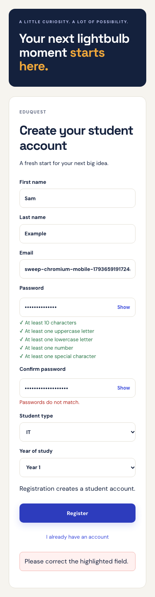
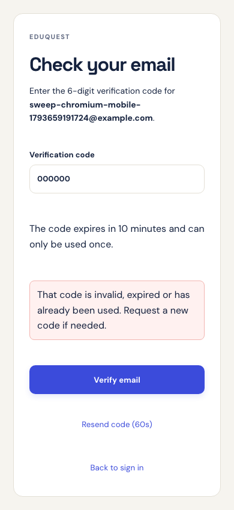

# Registration branch experience — 3 November 2026

Live site: **https://eduquest-dun.vercel.app**.

The follow-up restores the `Register-page-fixed` registration experience:
required surname in the public form, password visibility controls, individual
password rules directly below the password field, inline errors, student type
and study year, followed by the six-digit **Check your email** screen.
Legacy API clients may still omit a surname; the public form matches the branch.

Unverified users return to the code screen after login or refresh. Verification
uses the server-confirmed user rather than assigning verification in the browser.
Existing MFA login, recovery, profile and OpenRouter behavior are retained.

## Code security

- A code belongs to the signed-in account; clients cannot supply another email
  address or user ID when verifying or resending.
- Each challenge has a fresh nonce and a keyed HMAC. Plain codes are never stored
  in PostgreSQL or returned by the API. They expire after ten minutes.
- Five incorrect guesses lock that challenge. Resends have a persistent sixty
  second cooldown and replace the previous challenge.
- Row locks and transactions allow only one successful consumption. Code and
  legacy-link verification use consistent lock ordering and invalidate each other.
- Existing long verification links remain available for compatibility and pending
  email changes; they share the same verification state.

## Delivery

Production uses authenticated Gmail SMTP with implicit TLS on port 465. The app
password lives only in private local configuration and encrypted Vercel server
variables. Offline suites explicitly use private development mail files and
mocked SMTP, so automated fixture registrations do not send external email.

The live registration sent a real email to the supplied Gmail inbox. The user
provided the received code, which was successfully entered on the deployed OTP
screen. Dashboard navigation and refresh passed; replay returned HTTP 422.
No inbox code, password or private session material is included in this report.

## Validation

| Check                                                      | Result                                                                                       |
| ---------------------------------------------------------- | -------------------------------------------------------------------------------------------- |
| JavaScript unit/component tests                            | 246 passed, zero skipped                                                                     |
| Database/API tests                                         | 345 passed, zero skipped                                                                     |
| Registration and MFA browser matrix                        | 12 passed across Chromium/Firefox at 390, 768 and 1280px                                     |
| Backup and seed safety                                     | Populated round-trip passed with 28 migrations and 45 tables; repeated seed preserved counts |
| Lint, project type-check, formatting and production build  | Passed                                                                                       |
| Live Gmail delivery, inbox code entry and replay rejection | Passed                                                                                       |

API checks cover account binding, keyed hash storage, expiry, five-guess lockout,
resend cooldown, concurrent consumption, pending email changes and code/link races.
Browser checks include password controls, required form fields, mismatches,
refreshing the OTP step, wrong codes, cooldown feedback and successful verification.

